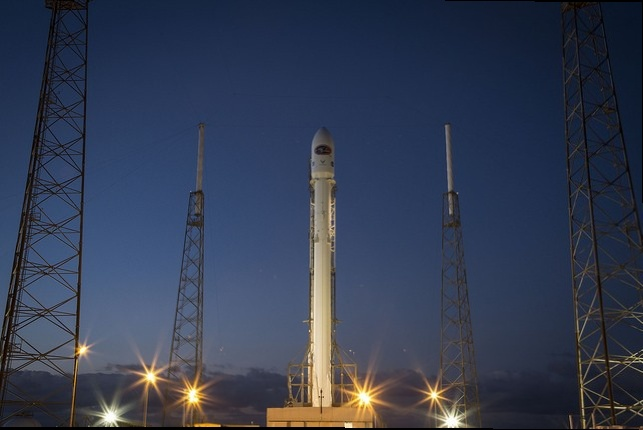

# Feature-Based Panorama Stitching

Stitch overlapping images with OpenCV features and a NumPy implementation of normalized DLT and RANSAC. The pipeline matches consecutive source images and composes their homographies into one canvas.



The demo stitches three overlapping crops of one photograph. It provides a controlled geometry example with known overlap.

## Quick start

Requires Python 3.10+. In an activated virtual environment:

```bash
python -m pip install -r requirements.txt
python src/panorama.py --input examples/tiles --output outputs/panorama.jpg --save-matches outputs/matches
```

The CLI reports inliers for each pair. `--save-matches` writes one visual check per pair. Try `--feature sift` to compare with the default ORB features.

## Algorithm

1. Read views in filename order and extract keypoints and descriptors.
2. Use a two-neighbor ratio test to filter tentative feature matches.
3. Use four-point normalized DLT inside RANSAC, then refit the homography from geometrically consistent matches.
4. Compose each view's transform into the first image's coordinates and warp the source images.
5. Build binary coverage masks independently of pixel colors, then feather overlaps and crop to the covered extent.

For your own images, use ordered filenames such as `01.jpg` and `02.jpg`, provide substantial overlap and keep the output outside the input folder. The project assumes that one homography can align each pair. Strong parallax, moving objects and accumulated drift over long sequences can produce visible seams.

## Verify

```bash
python -m unittest discover -s tests
```

The tests cover known projective geometry, degenerate correspondences, RANSAC outliers, black-pixel coverage and invalid canvas projections.

## Credits

SpaceX's public-domain DSCOVR launchpad image comes from [scikit-image](https://scikit-image.org/docs/stable/api/skimage.data.html#skimage.data.rocket). The example tiles are crops, and the panorama is a result of running this repository's code. See [LICENSE](LICENSE) for the source code.

CI checks installation, dependency compatibility, unit tests and CLI examples on Python 3.12 for each push and pull request. You can also run it from the Actions tab.
